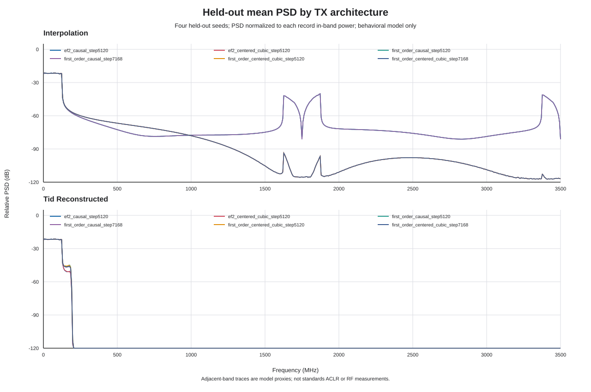
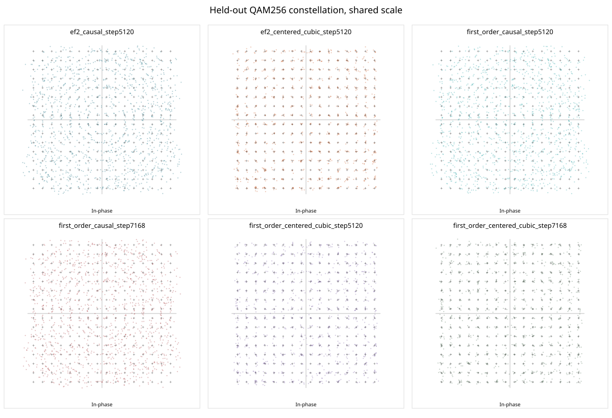

# Thermo5 TX Design Ablation — Linux Evidence

- **Status:** `LINUX_ALGORITHM_AND_DPD_AB_COMPLETE; CANDIDATES_NOT_PROMOTED`
- **Date:** 2026-10-30 (Asia/Singapore)
- **RTL product change:** none
- **Product configuration remains:** centered-cubic x2+x2, EF2 ORDER=2,
  STEP=5120, 20-bit state, DPD one-tap identity.

## Controlled benchmark contract

The four primary cells use the same Q1.15 256-QAM OFDM stimuli and held-out
seed list, `RMS=0.10`, 4096-point FFT, 512-sample cyclic prefix, 584 active
subcarriers, 250 MHz occupied bandwidth, 4097-tap receive/reconstruction
filters, and the same nominal/stress behavioral DPA, output-network, and
kTB+NF assumptions. Four disjoint development seeds are used only for
development reporting; the four held-out seeds are used for candidate
comparison. Each seed contains 12 OFDM symbols. The first-order
`STEP=7168` rows are shown separately as a historical threshold sensitivity;
the A/B architecture comparison uses `STEP=5120` for both TIDSM orders.

EVM and SNDR are measured digitally from the reconstructed four-plane stream
after one global complex equalizer. BER is uncoded natural-binary bit labeling,
not Gray-coded BER and not FEC BER. The same receiver timing convention is
used for every cell: known offline filter delay is compensated, TID pipeline
latency is removed at the model boundary, and no candidate-specific symbol or
fractional-delay fit is applied. Centered-cubic requires up to 2.25 future
source-sample dependencies in block interpolation; this number is a streaming
look-ahead requirement, not measured RTL latency. The causal method is the
actual RTL two-tap `[0.5, 0.5]` midpoint cascade.

## Held-out four-cell matrix

Each row aggregates 4 seeds and 224,256 uncoded bits. The EVM/SNDR values are
the mean across the four per-seed measurements; worst-seed values are listed
for the main quality metric.

| Cell | Interpolator / TIDSM | Errors / bits (uncoded natural binary) | BER | Mean / worst EVM | Mean / worst SNDR | Mean source / interpolated PAPR | Input / state clamp samples | Interpolation image / adjacent-band proxy |
| --- | --- | ---: | ---: | ---: | ---: | ---: | ---: | ---: |
| A | Causal / first order, STEP 5120 | 48,276 / 224,256 | 0.215272 | 20.915% / 21.034% | 13.591 / 13.542 dB | 10.299 / 10.380 dB | 0 / 0 | -20.726 / -24.336 dBc |
| B | Centered cubic / first order, STEP 5120 | 947 / 224,256 | 0.004223 | 3.443% / 3.483% | 29.261 / 29.161 dB | 10.299 / 10.329 dB | 0 / 0 | -78.999 / -24.186 dBc |
| C | Causal / EF2, STEP 5120 | 48,125 / 224,256 | 0.214598 | 20.824% / 20.916% | 13.629 / 13.590 dB | 10.299 / 10.380 dB | 0 / 0 | -20.726 / -26.076 dBc |
| D | Centered cubic / EF2, STEP 5120 (product) | 21 / 224,256 | 9.3643e-5 | 2.464% / 2.490% | 32.168 / 32.076 dB | 10.299 / 10.329 dB | 0 / 0 | -78.999 / -25.788 dBc |

The interpolation image column is a deterministic PSD integral around the
first image at the 1.75 GHz source-rate offset. The adjacent-band column is an
integrated simulation proxy from the reconstructed TID stream; it is **not**
standards ACLR. Mean interpolator fixed-point error is 0.356 LSB RMS (0.75 LSB
maximum) for the causal path and 0.265 LSB RMS (0.8125 LSB maximum) for
centered cubic, measured against the high-precision same-coefficient cascade.

## Separate first-order STEP sensitivity

| Centered-cubic first-order setting | Errors / bits | BER | Mean / worst EVM | Mean SNDR | Adjacent-band proxy |
| --- | ---: | ---: | ---: | ---: | ---: |
| STEP 5120 | 947 / 224,256 | 0.004223 | 3.443% / 3.483% | 29.261 dB | -24.186 dBc |
| STEP 7168 | 697 / 224,256 | 0.003108 | 3.267% / 3.320% | 29.718 dB | -24.653 dBc |

STEP 7168 improves this finite first-order held-out set. Its held-out digital
mean/worst-seed EVM is 3.267%/3.320%; nominal-chain mean EVM is 3.365%, while
the stress-chain mean EVM is 3.679%, above the 3.5% screening threshold. The
3.5% value is a screening reference, not an approved product requirement. This
historical setting does not alter the product STEP=5120 decision.

## Interpretation and candidate disposition

| Candidate | Linux evidence | Decision |
| --- | --- | --- |
| D — Centered-cubic + EF2, STEP 5120 | Best digital BER/EVM/SNDR of the tested matrix; 0 input/state saturation; existing product UVM/Four-plane identity evidence retained | **Keep as frozen product baseline.** This is a model screen, not physical QAM256 signoff. |
| A/C — Causal interpolation | About 20.8% EVM and 0.215 BER in both first- and second-order cases; first interpolation image is about 58 dB higher than centered cubic | **Reject for this modeled communication target.** The fixed RTL sample-time mapping and receiver are common; this is not a candidate-specific timing search. |
| B — Centered-cubic + first order, STEP 5120 | EVM 3.443%, BER 0.004223, SNDR 29.261 dB | **Keep as comparison baseline only.** EF2 improves this finite held-out set; product target limits remain undefined. |
| Centered-cubic + first order, STEP 7168 | Better than STEP 5120 on the first-order subset, still behind the product EF2 row | **Sensitivity/reference only.** Not promoted to product. |
| EF2 pair look-ahead=1 | Existing 4096-cycle VCS miter and scoped Formal equivalence pass | **Defer hardware adoption.** No same-device LUT/FF/DSP, Fmax, routed timing, or power comparison exists. |
| Fitted 2/4-tap DPD | ILA fit on nominal behavioral DPA using four development seeds; Q2.14 quantized; four disjoint held-out seeds; 93,184-sample VCS vector miter per tap configuration | **Defer promotion.** Both fitted images are bit-true, but neither shows a reliable held-out communications gain over identity. |

Comparing the matched cells separates the two gains. Under EF2, replacing
causal interpolation with centered cubic moves held-out EVM from 20.824% to
2.464% and BER from 0.214598 to `9.3643e-5`. Under centered cubic, moving
first-order STEP 5120 to EF2 STEP 5120 moves EVM from 3.443% to 2.464%, BER
from 0.004223 to `9.3643e-5`, and SNDR from 29.261 dB to 32.168 dB. The causal
interpolator's image rejection is the largest difference in this experiment.

## EF2 pair look-ahead structure

The scalar implementation walks 32 chronological lanes in one unrolled
combinational cone. For each lane, the quantizer decision selects the error
state consumed by the next lane, so the serial dependency includes the next
lane's state-feedback addition before its quantizer decision. The pair
candidate precomputes both saturated `e0` choices and both corresponding
`u1` arithmetic results, then selects `u1` using `q0`; this removes that
feedback-selected addition from the `q0`-to-`q1` path. It adds a second `u1`
arithmetic path and a selection mux. The 32 sample decisions remain
chronological and the interface cycle/throughput contract is unchanged. This
is a structural RTL observation, not a synthesized delay or critical-path
measurement.

The VCS miter compares both implementations' output handshake, output data,
and all four EF2 state registers over 4,096 cycles. The added directed vector
sets the final pair's `u0` to exactly zero (`x0=-32768`, `e1=32768`,
`e2=32768`), checking the negative tie rule. The passing run also observes
positive/negative clamp activity, 817 output-stall cycles, 616 input-bubble
cycles, and a drained midstream reset epoch. The existing scoped VC Formal
equivalence result is retained; it was not rerun for this testbench-only
change. Same-device LUT/FF/DSP, WNS/Fmax, routed timing, and power remain
`NOT_RUN` without Vivado.

## Output-chain sensitivity

For the product D cell, the nominal modeled DPA/output/noise case produced 32 /
224,256 errors (BER `1.4269e-4`), 2.595% mean EVM, and -30 dBm modeled mean
output power. The stress case produced 173 / 224,256 errors (BER
`7.7144e-4`), 2.998% mean EVM, and -50 dBm modeled mean output power. These
profiles are illustrative settings from the repository's behavioral models;
they are not measured/calibrated PA, board, DAC, or noise data.

## Fitted DPD A/B and RTL check

The fitter uses indirect learning on the existing nominal `BehavioralDPA`
profile. It regresses desired samples against PA-output memory-polynomial
features `y[n-k]`, `y[n-k]|y[n-k]|^2`, and `y[n-k]|y[n-k]|^4`, with a relative
ridge term of `1e-5`. Four development seeds, 12 symbols/seed, and 31,600
selected non-guard training samples are used. The two- and four-tap solutions
have no coefficient clipping and are rounded to signed Q2.14. Exact integer
images are preserved in
[`thermo5-tx-dpd-ila-coefficients.json`](data/thermo5-tx-dpd-ila-coefficients.json).

Held-out evaluation uses four seeds, nine symbols/seed, STEP 5120, 20-bit EF2,
the fixed receiver, and the same nominal/stress output models. Every candidate
has 168,192 uncoded bits. Wilson 95% intervals are included in the full data;
the identity and fitted-candidate intervals overlap.

| Coefficient image | Digital errors / bits | Digital BER | Mean EVM / SNDR | Nominal modeled BER | Stress modeled BER | Decision |
| --- | ---: | ---: | ---: | ---: | ---: | --- |
| 1-tap identity | 7 / 168,192 | 4.1619e-5 | 2.465% / 32.164 dB | 7.7293e-5 | 7.3131e-4 | Keep reference |
| Existing verification 2-tap image | 126 / 168,192 | 7.4914e-4 | 3.043% / 30.333 dB | 1.2188e-3 | 3.0917e-3 | Reject this hand-picked image |
| Existing verification 4-tap image | 1,125 / 168,192 | 6.6888e-3 | 4.051% / 27.849 dB | 8.4725e-3 | 1.3217e-2 | Reject this hand-picked image |
| Nominal ILA 2-tap Q2.14 | 8 / 168,192 | 4.7565e-5 | 2.489% / 32.082 dB | 1.2486e-4 | 8.7995e-4 | Defer; no reliable gain vs identity |
| Nominal ILA 4-tap Q2.14 | 12 / 168,192 | 7.1347e-5 | 2.483% / 32.100 dB | 1.3675e-4 | 6.4212e-4 | Defer; stress-only improvement is not enough |

| Coefficient image | Nominal / stress adjacent-band proxy (dBc) | Nominal / stress modeled Pout (dBm) | Nominal / stress PA-output PAPR (dB) |
| --- | ---: | ---: | ---: |
| 1-tap identity | -25.666 / -25.661 | -30.000 / -50.000 | 10.478 / 10.413 |
| Existing verification 2-tap | -25.725 / -25.718 | -29.453 / -49.455 | 10.529 / 10.450 |
| Existing verification 4-tap | -25.811 / -25.803 | -29.097 / -49.101 | 10.535 / 10.445 |
| Nominal ILA 2-tap Q2.14 | -25.661 / -25.657 | -29.998 / -49.998 | 10.474 / 10.409 |
| Nominal ILA 4-tap Q2.14 | -25.686 / -25.683 | -29.999 / -49.999 | 10.485 / 10.420 |

Both fitted candidates had zero digital DPD output saturation in their
standalone RTL miter stimuli. The modeled PA AM-AM curves compressed
693,678–698,095 nominal-profile samples and 730,686–730,769 stress-profile
samples over the four held-out seeds; these are deterministic model
compression counts, not digital clamps. The adjacent-band metric is an
integrated simulation proxy, not ACLR. These figures show no meaningful
spectral benefit from the fitted candidates relative to identity under the
current uncalibrated PA assumptions.

Fitted 2-tap is slightly worse than identity in this held-out digital set;
fitted 4-tap has a modestly lower stress BER but worse digital and nominal BER.
The finite-seed differences are within overlapping BER intervals, while the
coefficients are fitted to an uncalibrated deterministic DPA model. There is
not enough evidence to replace the one-tap product. The prior arbitrary
verification images are definitively worse for these seeds, but that result
does not reject all 2/4-tap DPDs.

For RTL verification, Python generated 16-lane input vectors and independent
expected output samples with the fitted Q2.14 image. VCS instantiated the
existing `dpd_vector16_memory_poly` plus `dpd_memory_poly` datapath and matched
all 93,184 I/Q sample pairs for the fitted 2-tap and 4-tap cases, with zero
output saturation. These candidate-only VCS runs are not merged into product
coverage. The standalone test verifies the DPD arithmetic and sample order;
it does not prove full AXI-Lite coefficient transport with the fitted image,
nonlinear PA equivalence, or hardware resource cost.

The held-out DPD run also records modeled PA input/output PAPR, samples
compressed by the behavioral AM-AM curve, and an integrated adjacent-band
power proxy for nominal and stress profiles. The proxy integrates both
125–375 MHz adjacent regions from a 4,096-bin Blackman-window PSD over the
reconstructed 7 GHz complex stream. It is not standards ACLR. Per-seed and
summary values are in the DPD JSON data. DPD output saturation was zero for
each fitted candidate's 93,184-sample vector miter; PA envelope compression is
reported separately from digital saturation.

For EF2, the sign quantizer deliberately has an unbounded decision input; the
reported `quantizer_overrange_samples` counts `|u| > 1` before its sign
decision. It is not a state clamp or input clip. Across the 4 held-out product
seeds, input clipping and 20-bit state saturation are both zero. Per-cell raw
counts remain in the JSON data.

## Reproduction artifacts

The exact commands, compact per-seed JSON, summary CSV, compressed PSD CSV,
spectrum and constellation SVGs, coefficient fit, local VCS log/vector hashes,
and SHA-256 hashes are indexed in
[`thermo5-tx-design-ablation-evidence.json`](thermo5-tx-design-ablation-evidence.json).
Full simulator logs and vector files remain under the ignored `runs/`
directory; compact review data and figures are committed under [`data/`](data/).

## Signoff boundary

The 4-seed held-out result has nonzero uncoded errors and no FEC. No target
owner has defined BER/BLER, EVM, SNDR, output-power, or ACLR acceptance limits.
Therefore this report establishes a reproducible **relative model ranking**,
not a stable physical QAM256 link. Product VCS code coverage is unchanged from
the PR #7 source-linked result: Raw aggregate 81.99%, with 170/170 legally
applicable functional bins and `RAW_100_OPEN`. No new Raw coverage VDB is
merged here. XPM/GT Wizard simulation, FPGA PPA/routed timing, and physical
QAM256 BER remain `NOT_RUN`/`OPEN`.
